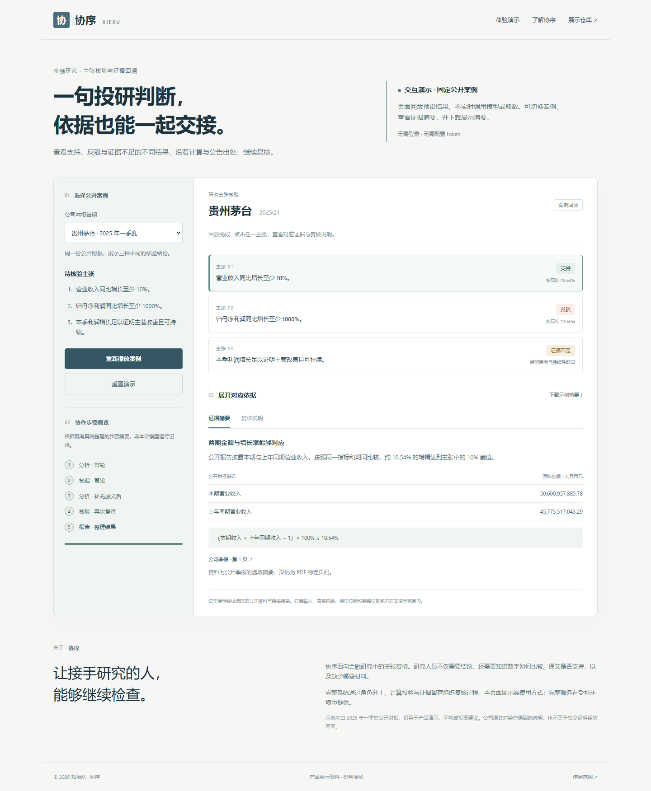

# 协序 · 产品演示

**投研主张核验与证据回溯工作台**

[打开在线演示](https://rosex5711.github.io/xiexu-demo/)

协序关注研究结论交接时的证据复核：数字怎样比较、公司原文是否支持某个表述、哪些条件仍然缺失。

本仓库提供固定公开案例的交互演示，便于了解产品的使用方式。页面回放预设结果，不实时调用大模型或财务接口。



## 怎样体验

1. 选择贵州茅台或美的集团的 2025 年一季度案例。
2. 点击“播放案例”，查看协作步骤概览。
3. 点击不同主张，比较支持、反驳和证据不足的结果。
4. 展开证据摘要，查看公开金额、示例公式、原文摘要及公告页码。
5. 打开公司公告，或下载本案例的展示摘要。

| 案例 | 展示内容 |
| --- | --- |
| 贵州茅台 2025Q1 | 收入增长阈值获支持、错误利润增长阈值被反驳、原因与持续性主张保留证据不足 |
| 美的集团 2025Q1 | 对照两处公司说明，识别把不同事项的解释接错的表述 |

步骤文案为案例概述，不是原始模型输入输出。下载文件只包含当前演示的结果摘要。

## 展示范围

本仓库只包含展示页面、预设案例摘要和使用说明。页面没有接入协序服务端，不支持任意公司或自由输入的真实核验，也不产生模型或取数费用。

完整系统在受控环境中提供财务数据获取、主张复核、证据留存与阶段恢复等能力。本仓库不分发核心实现、角色提示词、Skill、数据适配器、原始接口响应或内部运行日志。

## 本地查看

下载本仓库，在目录中运行任意静态文件服务，例如：

```bash
python -m http.server 8000
```

打开 [本地演示](http://127.0.0.1:8000/)。无需安装项目依赖或配置认证信息。

## 资料与使用范围

- [公开资料来源](SOURCES.md)
- [版权与使用范围](RIGHTS.md)

本仓库为产品展示资料，保留相关权利，不是协序完整系统的开源发布。示例仅用于演示，不构成投资建议。

© 2026 知衡队
